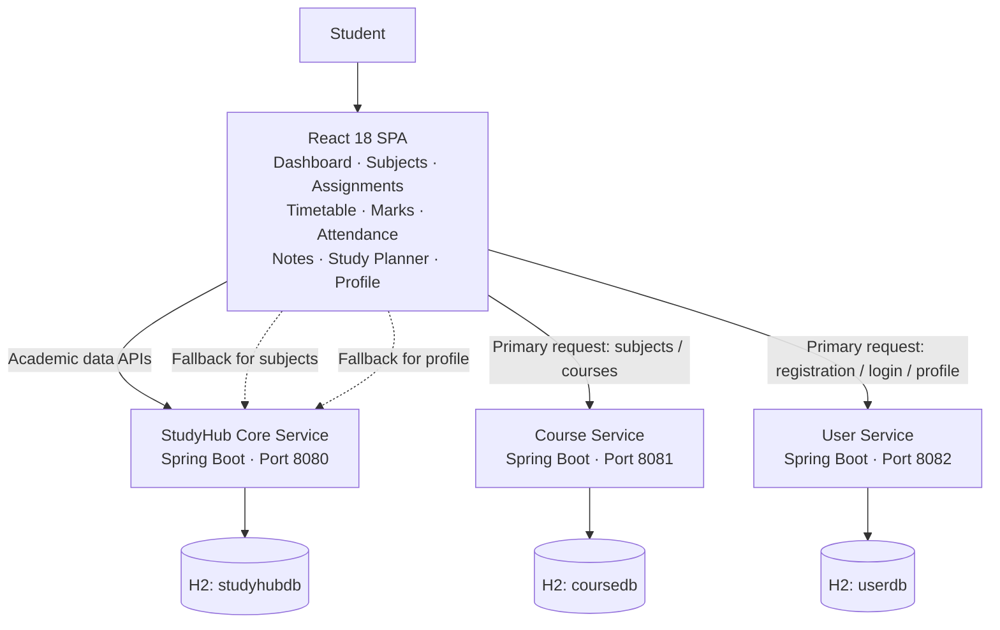
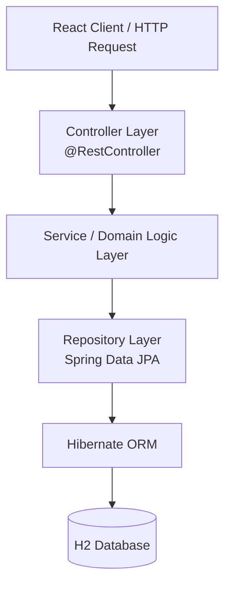
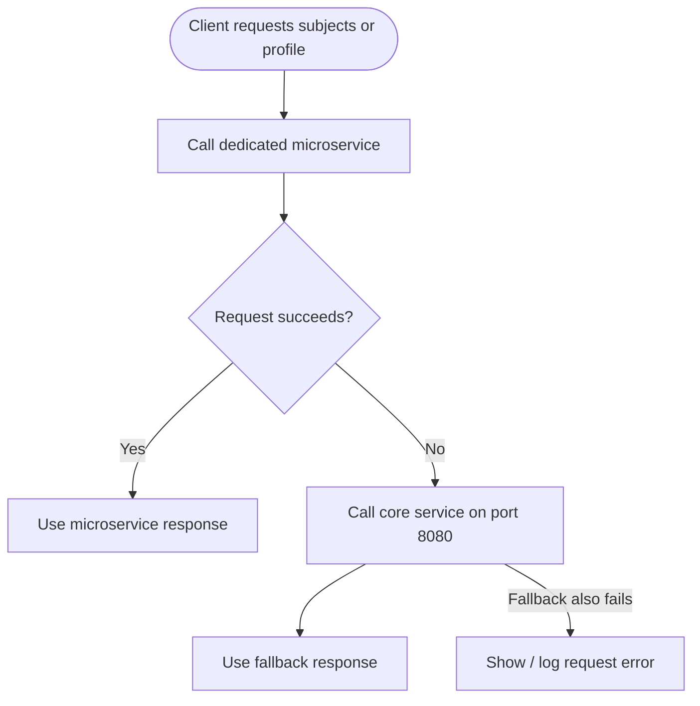

> Your semester already has enough plot twists. Your attendance percentage shouldn't be one of them. 🎓

# StudyHub — Your Academic Life, Minus the Chaos

**StudyHub** is a microservice-based academic management and student productivity platform that brings subjects, assignments, timetables, marks, attendance, notes, study tasks, and profile management into one responsive web application.

Instead of juggling screenshots, spreadsheets, chat reminders, and mental maths, students get one place to organise their semester—and get useful answers from the data they enter.

<p>
  
  
  
  
  
  
</p>

---

## The problem StudyHub solves

A student's academic life is usually scattered across multiple places: the timetable in one app, assignment deadlines in a group chat, attendance in a portal, marks in a spreadsheet, and revision notes somewhere in a notebook.

StudyHub brings these workflows together and turns academic records into actionable feedback. It is designed primarily for undergraduate and engineering students who want to keep track of their semester before deadlines and attendance shortages become emergencies.

## Features at a glance

| Module | What it does |
|---|---|
| **Dashboard** | Shows a personalised welcome, CGPA and attendance summaries, today's classes, pending assignments, and quick study tasks. |
| **Subjects** | Manages registered subjects and their course details, including code, credits, faculty, classroom, and syllabus information. |
| **Assignments** | Tracks due dates, priorities, descriptions, and status. Filter assignments by All, Pending, Submitted, and Overdue. |
| **Timetable** | Maintains a weekly class schedule and supports day-wise filtering. Today's classes are highlighted on the dashboard. |
| **Marks / CGPA** | Records internal and external marks, calculates grades and grade points, and produces credit-weighted SGPA/CGPA summaries. |
| **Attendance** | Records attendance class by class, displays subject-wise percentages and status, and provides a **Bunk Advisor** against the 75% requirement. |
| **Notes Vault** | Stores subject-wise revision notes with titles, icons, timestamps, and a full-note view. |
| **Study Planner** | Organises study tasks by priority and time block, with completion tracking and productivity metrics. |
| **Profile** | Provides student registration, login, and profile viewing/editing through the User Service. |

### A little more than just data entry

- **Automatic grading:** Enter internal and external marks and let the backend calculate the total, grade, and grade points.
- **Credit-weighted GPA:** Summary values are calculated on the server instead of being independently recomputed by the browser.
- **Attendance guidance:** See whether a subject is Safe, Warning, or Critical—and how many classes can be missed or must be attended.
- **Assignment workflow:** Move work between Pending and Submitted; overdue work is identified from its due date and status.
- **Pomodoro focus sessions:** Focus for 25 minutes, take a 5-minute short break, or a 15-minute long break.
- **Contextual search:** Search within the active module, with case-insensitive filtering.
- **Action feedback:** Create, update, and delete actions provide success or error feedback through toast messages.
- **Graceful service fallback:** The client tries the relevant microservice first and falls back to the core service for subjects and profile data when needed.

---

## Architecture

StudyHub uses a React single-page application (SPA) with three independently running Spring Boot services. Each backend service owns its own H2 database; services do not directly read one another's databases.



### Service responsibilities

| Service | Port | Database | Responsibilities |
|---|---:|---|---|
| **StudyHub Core** | `8080` | `studyhubdb` | Assignments, timetable, marks, attendance, notes, and tasks. It also acts as the fallback for subjects and profile operations. |
| **Course Service** | `8081` | `coursedb` | Course and subject catalogue operations. It exposes `/api/subjects` aliases to preserve the client-facing subject API. |
| **User Service** | `8082` | `userdb` | Student registration, login, user listing, and profile read/update operations. |

### Inside each Spring Boot service

Each service follows a layered Controller–Service–Repository design. HTTP concerns stay in controllers, domain rules live in the service/domain layer, and repositories handle persistence through Spring Data JPA and Hibernate.



### Client-side fallback flow

For subjects and profile data, the React client attempts the dedicated microservice first. If that request fails, it retries against the corresponding core-service endpoint. The goal is to keep the UI usable even when one of the extracted services is unavailable.



---

## Tech stack

### Frontend

- **React 18** — component-based single-page interface.
- **JSX** — UI composition.
- **React Hooks** — client state and lifecycle handling (`useState`, `useEffect`).
- **Babel Standalone** — browser-side JSX compilation, loaded through `index.html`.
- **Fetch API** — REST communication with the backend services.

### Backend

- **Java 21**
- **Spring Boot 4** with `spring-boot-starter-webmvc`
- **Spring Data JPA**
- **Hibernate ORM**
- **REST APIs** exchanging JSON over HTTP
- **CORS** enabled for browser-to-service communication

### Data layer

- **H2 Database** — one database per service.
- **JPA / Hibernate** — entity mapping and persistence.
- The report documents in-memory H2 configuration and `ddl-auto=update` for the core service.

---

## Academic logic

One of StudyHub's main goals is to calculate useful academic information on the server rather than simply storing raw numbers.

### Grade calculation

Internal and external marks are each out of 50:

```text
Total Marks = Internal Marks + External Marks
```

| Total marks | Grade | Grade points |
|---:|:---:|---:|
| 90–100 | O | 10 |
| 80–89 | A+ | 9 |
| 70–79 | A | 8 |
| 60–69 | B+ | 7 |
| 50–59 | B | 6 |
| 40–49 | C | 5 |
| Below 40 | F | 0 |

### Credit-weighted GPA

The backend calculates the GPA summary using credits and grade points:

$$
\mathrm{GPA} = \frac{\sum_{i=1}^{n} (\mathrm{Credits}_i \times \mathrm{GradePoints}_i)}{\sum_{i=1}^{n} \mathrm{Credits}_i}
$$

The result is rounded to two decimal places. The marks summary exposes total credits, SGPA, CGPA, and course count.

### Attendance tracker and Bunk Advisor

Attendance percentage is calculated as:

```text
Attendance % = (Classes Attended / Total Classes) × 100
```

When no classes have been held yet, the implementation reports 100% attendance.

| Attendance | Status |
|---:|---|
| 75% and above | **Safe** |
| 65% to 74.9% | **Warning** |
| Below 65% | **Critical** |

For the 75% attendance threshold, the advisor uses the following guidance:

- **When above 75% — classes that can be missed:**
  `floor(attended / 0.75 - total)`
- **When below 75% — classes that must be attended consecutively:**
  `ceil(3 × total - 4 × attended)`

The threshold is represented by a configurable `targetPercentage` field in the attendance model; the formulas documented in the project report are shown above for the 75% rule.

### Pomodoro timer

| Mode | Duration |
|---|---:|
| Focus | 25 minutes |
| Short break | 5 minutes |
| Long break | 15 minutes |

Completed focus sessions update the productivity session counter. **Current behaviour:** Pomodoro session tracking is held in the browser session and is not persisted across a page refresh.

---

## API overview

The project report documents **48 REST endpoints** across the three services: 38 core, 5 User Service, and 5 Course Service endpoints. The routes below summarise the main API contract described in the report.

### StudyHub Core — `http://localhost:8080/api`

| Method | Endpoint | Purpose |
|---|---|---|
| `GET`, `POST` | `/subjects` | List or create subjects (also used as a fallback). |
| `GET`, `POST` | `/assignments` | List or create assignments. |
| `PUT`, `DELETE` | `/assignments/{id}` | Update or delete an assignment. |
| `PATCH` | `/assignments/{id}/status` | Change assignment status. |
| `GET`, `POST` | `/timetable` | List or create timetable slots. |
| `GET` | `/timetable/day/{day}` | Retrieve slots for a weekday. |
| `PUT`, `DELETE` | `/timetable/{id}` | Update or delete a timetable slot. |
| `GET`, `PUT` | `/profile` | Read or update the fallback student profile. |
| `GET`, `POST` | `/marks` | List or add academic records. |
| `GET` | `/marks/summary` | Return total credits, SGPA, CGPA, and course count. |
| `PUT`, `DELETE` | `/marks/{id}` | Update or delete a marks record. |
| `GET`, `POST` | `/attendance` | List or create attendance records. |
| `GET` | `/attendance/summary` | Return overall attendance percentage and status. |
| `PATCH` | `/attendance/{id}/mark?present=true or false` | Mark a class as present or absent. |
| `GET`, `POST` | `/notes` | List or create notes. |
| `GET`, `POST` | `/tasks` | List or create study tasks. |
| `PATCH` | `/tasks/{id}/toggle` | Toggle task completion. |

### User Service — `http://localhost:8082/api`

| Method | Endpoint | Purpose |
|---|---|---|
| `POST` | `/users/register` | Register a student. |
| `POST` | `/users/login` | Authenticate and return the student profile. |
| `GET` | `/users` | List registered users. |
| `GET`, `PUT` | `/profile` and `/users/profile` | Read or update profile information. |

### Course Service — `http://localhost:8081/api`

| Method | Endpoint | Purpose |
|---|---|---|
| `GET`, `POST` | `/courses` | List or create courses. |
| `GET`, `POST` | `/subjects` | Subject-compatible aliases for list/create operations. |
| `GET`, `PUT`, `DELETE` | `/courses/{id}` | Fetch, update, or delete a course. |

> The API overview is a practical summary, not a substitute for the controller definitions. Check the service source for request-body fields and any additional routes.

---

## Run locally

### Prerequisites

- Java **21**
- A modern browser with JavaScript enabled
- A local static-file server for the React client
- Maven or the Maven Wrapper, **if that is what your service projects use**

### 1. Start the backend services

Run each Spring Boot application from its own project directory. The services are expected to listen on these ports:

| Application | Port |
|---|---:|
| StudyHub Core | `8080` |
| Course Service | `8081` |
| User Service | `8082` |

For a Maven-based service that includes the Maven Wrapper, the usual command is:

```bash
./mvnw spring-boot:run
```

Run that command separately from each service's directory, in three terminals. If the project uses a different build setup, launch the corresponding Spring Boot main class using that setup instead.

### 2. Start the frontend

The report describes a React client loaded through `index.html`, with JSX compiled using Babel Standalone. Serve the directory containing `index.html` over HTTP rather than opening the file directly.

For example, from the frontend directory:

```bash
python3 -m http.server 5500
```

Then open:

```text
http://localhost:5500
```

The frontend's documented API base URLs are:

```javascript
const API_BASE   = 'http://localhost:8080/api';
const API_COURSE = 'http://localhost:8081/api';
const API_USER   = 'http://localhost:8082/api';
```

Keep the service ports aligned with these values, or update the API base URLs in the client if you use different ports.

### 3. Development database

The report documents H2 in-memory databases for the services. The core service uses:

```text
jdbc:h2:mem:studyhubdb
```

The core service seeds sample data at startup through a `DataLoader` (`CommandLineRunner`). Since the databases are in-memory, data is not intended to survive a service restart.

The H2 web console is available for development inspection where enabled at `/h2-console`. Do not expose a development database console publicly.

> **Repository-specific note:** The report specifies the runtime architecture and ports, but does not specify the exact repository folder names or build scripts. The commands above are therefore intentionally directory-agnostic; use the actual service/frontend directory names in your checkout.

---

## Testing and project outcomes

StudyHub was developed individually using **Agile Scrum across three sprints**. The product backlog contained 12 user stories, all of which were completed.

| Sprint | Focus | User stories completed | Functional tests passed |
|---|---|---:|---:|
| Sprint 1 | Core organiser: dashboard, subjects, assignments, timetable | 4 / 4 | 8 / 8 |
| Sprint 2 | Marks, CGPA, attendance, notes, study planner | 4 / 4 | 8 / 8 |
| Sprint 3 | User and Course microservices, fallback, search, feedback | 4 / 4 | 8 / 8 |
| **Total** | | **12 / 12** | **24 / 24** |

Other reported outcomes:

- **71 / 71 story points** completed across the three sprints.
- **48 REST endpoints** documented across the three services.
- Successful fallback test with the Course Service stopped; subjects were loaded from the core service.
- Seed-data example in the report: **22 credits and 9.55 CGPA**, with overall attendance of **88.0%**.

---

## Current limitations

StudyHub is a working academic project and prototype. The following limitations are acknowledged in the project report and should be addressed before production use:

- **Authentication security:** Passwords are currently stored without BCrypt hashing. JWT-based authentication and Spring Security protection are future enhancements.
- **Single-student assumptions:** Multi-user data isolation is not yet implemented; a StudyHub instance is assumed to be used by one student.
- **In-memory persistence:** H2 data is lost when the service restarts. A persistent database is needed for production use.
- **Hard-coded service URLs:** The frontend currently uses fixed local ports; there is no API gateway or service discovery.
- **Pomodoro persistence:** Focus-session history is not persisted across browser refreshes.
- **Deployment automation:** Docker packaging and CI/CD are not part of the current implementation.

**Do not use the current prototype to store real credentials or sensitive student information.**

---

## Roadmap

- [ ] Add BCrypt password hashing, JWT access tokens, and Spring Security.
- [ ] Add multi-user support and enforce per-student data isolation.
- [ ] Replace in-memory H2 with PostgreSQL or MySQL and manage schema changes with Flyway.
- [ ] Introduce Spring Cloud Gateway and Eureka service discovery.
- [ ] Containerise the frontend and services with Docker; add Docker Compose or Kubernetes deployment support.
- [ ] Add a GitHub Actions build and test pipeline.
- [ ] Persist Pomodoro history and add study analytics.
- [ ] Add deadline and attendance-shortage reminders, semester CGPA trends, and what-if grade prediction.

---

## Project context

StudyHub was built as an individual **Full Stack Development** project. Its aim also aligns with **UN Sustainable Development Goal 4 — Quality Education** by helping students organise their workload, monitor academic risk earlier, and build more structured study habits.

---

## Author

**Pritam Dey**  
B.Tech — Computer Science and Engineering  
SRM Institute of Science and Technology

---

<p align="center"><i>Keep your notes close, your deadlines closer, and your attendance above 75%.</i></p>
